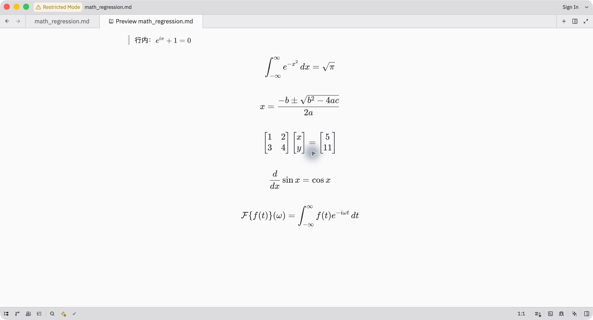

# Zed Native Math — Community Patch

Development source snapshot **0.1.1-dev** for **Zed 1.25.3**.

在 Zed 原生 Markdown 渲染器中显示 LaTeX 数学公式，覆盖 Agent 聊天与 Markdown 预览。不是网页预览，也不是可从扩展商店直接安装的插件。本项目与 Zed Industries 无隶属关系。

## 功能

- 行内 `$...$` 与 `\(...\)`，块级 `$$...$$` 与 `\[...\]`。
- 原生 RaTeX → SVG → GPUI 渲染，支持主题、字体和异步缓存。
- 覆盖 Zed 自带 Agent，以及通过 ACP 连接的外部 Agent。
- 修复多行公式中独立的 `=` / `-` 行被 CommonMark 当成标题标记，继而损坏矩阵换行、指数和环境名称的问题。
- 行内公式与中文按文字边界换行，括号跟随公式，避免聊天栏缩窄时文字越界。
- 保留代码块中的 LaTeX 源码，以及数学区域对应的原始字节位置。

以下截图来自原生 Markdown 视图，使用与 Agent 聊天相同的数学渲染组件：



## 验证范围

| 项目 | 状态 |
| --- | --- |
| Zed 基线 | `v1.25.3` / `8dd255c3eafb5231056fe4e6f601cedd011f1c93` |
| 实测平台 | Apple Silicon macOS |
| 原生数学测试 | 14 项通过，包含 Markdown → RaTeX → SVG → GPUI 图像解码 |
| 完整原生应用构建 | 通过 |
| Agent 聊天显示 | 本地验证通过 |
| 完整 Markdown 测试集 | 210 项通过，包含反复调整宽度、选择与复制 |
| Windows / Linux / Intel Mac | 未验证 |

数学命令支持范围取决于 RaTeX；不承诺完整 TeX 文档编译能力，也不承诺兼容其他 Zed 版本。

## 从源码构建

需要 Git、Python 3.9+、Rustup、CMake 和 macOS Command Line Tools。Rust 工具链固定为 `1.98.1`。构建会下载 Zed 的依赖并占用较多磁盘和时间；本工具不会自动安装系统依赖。

在本项目目录执行：

```sh
rustup toolchain install 1.98.1 --profile minimal

git clone --depth 1 --branch v1.25.3 --single-branch \
  https://github.com/zed-industries/zed.git ../zed-upstream

python3 build.py verify --source ../zed-upstream
python3 build.py apply --source ../zed-upstream
python3 build.py test --source ../zed-upstream
python3 build.py build --source ../zed-upstream
```

校验不支持的源码版本、补丁校验和错误或已有本地修改时，工具会停止；不会执行 `git reset` 或覆盖已有源码修改。

构建参数与本地验证一致：`gpui_platform/runtime_shaders,util/debug-embed`，运行时编译 Metal 着色器并嵌入资源。默认最多两个编译任务，可通过 `CARGO_BUILD_JOBS` 调整。工具不依赖作者的 Cargo/Rustup 缓存路径。

### 打包为独立 macOS 应用

先安装同版本的官方 `/Applications/Zed.app`，作为应用资源与辅助程序模板，再执行：

```sh
python3 build.py package --source ../zed-upstream \
  --template /Applications/Zed.app \
  --destination "$HOME/Applications/Zed Native Math (Community).app"
```

打包使用本机构建的可执行程序和临时签名。已有目标应用时拒绝覆盖。此构建未做 Apple 公证；本项目不提供预编译应用。

运行时使用 Zed stable 通道的数据目录，沿用该通道的本地配置与聊天数据。请保存文件、退出已有 Zed 实例后，再启动社区构建。

### 更新方式

该源码包没有后台任务、桌面脚本或自动更新器。定制应用的官方二进制覆盖更新会停用，以保留补丁。升级到其他 Zed 版本需要先适配、测试并发布新的补丁；不要对不受支持的版本强制应用当前补丁。

开发时使用的本机自动编译服务不在此包中：它依赖本地仓库、工具链缓存和安装状态，尚未整理为面向其他用户的安装器。

## 本仓库工具测试

```sh
python3 -m unittest discover -s tests -v
```

`manifest.json` 固定了基线提交和补丁 SHA-256。`patches/` 中的补丁含本地原生验证时使用的依赖锁文件。

## 来源与许可证

数学渲染实现移植自 [loomou 的 Zed PR #57339](https://github.com/zed-industries/zed/pull/57339)，参考提交 `0676a0c`。本补丁完成对 Zed 1.25.3 的适配，并增加括号分隔符、CommonMark 标题冲突修复及回归测试。不能把该实现全部标为本项目原创。

修改的 Zed crate 使用 **GPL-3.0-or-later**，此包的源码改动和构建工具按同一许可证提供，见 [LICENSE](LICENSE) 和 [NOTICE.md](NOTICE.md)。Zed、GPUI、RaTeX 及字体等上游项目保留各自的许可证和权利；此包不重新授权它们。

## 文件范围

此源码包只包含补丁、可移植构建工具、测试、文档和无个人信息的演示图。未包含任何用户设置、聊天记录、API 密钥、本机更新状态、构建缓存或可执行程序。
